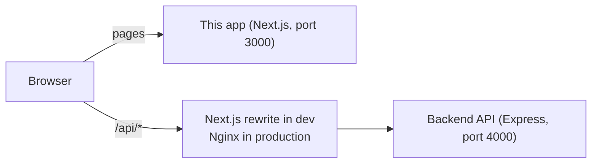
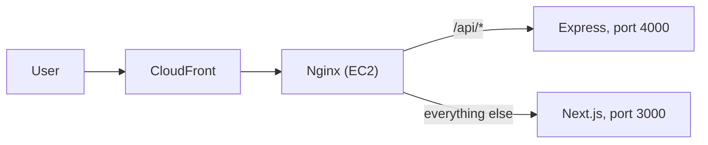

# DSA Sheet — Frontend

The website for a **DSA Sheet** app. Students log in, work through a list of
data-structures-and-algorithms problems (Chapters → Topics → Problems), tick off the ones
they've solved, and plan problems on a calendar.

This repo is **only the website** (Next.js). The API is a separate repo (Express + PostgreSQL).
The browser always calls relative `/api/...` URLs, so the website and the API look like one site,
and the login cookie just works. No CORS.



## What it does

| Page                       | What the user gets                                                                                                                      |
| -------------------------- | --------------------------------------------------------------------------------------------------------------------------------------- |
| **Log in / Sign up**       | Simple forms with clear errors. A "Fill in" button for the demo account.                                                                |
| **Sheet** (`/sheet`)       | Progress overall and per difficulty, chapters as accordions, tick problems (saved instantly), filter by difficulty, hide solved.        |
|                            | Opens at the first unsolved problem ("In progress"), so you carry on where you left off. Practice, video and article links per problem. |
| **Calendar** (`/calendar`) | Month grid (Monday first), "This week" summary, a day panel. Add problems to a day, mark Done / Skip, move, delete (with Undo).         |
|                            | Missed days are shown in red with "Move to today". Marking Done also ticks the problem on the sheet.                                    |
| **Everywhere**             | Light and dark mode, works on phones (375px wide), stays logged in for 7 days.                                                          |

Calendar rules (the backend enforces them too):

- A problem sits on **one date at a time**. Already planned problems are greyed out in the Add dialog, with their date.
- You can't plan on, or move to, a **past day**. Missed problems can still be marked done or moved to today or later.

## Tech stack

| Part        | Tool                                                                   |
| ----------- | ---------------------------------------------------------------------- |
| Framework   | Next.js 16 (App Router), React 19, TypeScript (strict mode)            |
| Styling     | Tailwind CSS v4                                                        |
| Components  | shadcn/ui (Radix), lucide-react icons, sonner toasts                   |
| Server data | TanStack Query (loading states, caching, instant "optimistic" updates) |
| Forms       | React Hook Form + Zod                                                  |
| Dates       | date-fns (the calendar is built by hand, no calendar library)          |
| Code style  | ESLint + Prettier (with Tailwind class sorting)                        |

## Getting started

You need **Node.js 20+**, and the **backend running on port 4000** (see the backend repo's README).

```bash
# 1. Install packages
npm install

# 2. (Optional) settings. Dev works without this: /api goes to http://localhost:4000 by default.
cp .env.example .env

# 3. Start the dev server
npm run dev                   # → http://localhost:3000
```

**Demo login:** `demo@dsasheet.dev` / `Demo@1234` (or press "Fill in" on the login page).

### Settings (`.env`)

| Name          | Example                 | What it's for                                                                      |
| ------------- | ----------------------- | ---------------------------------------------------------------------------------- |
| `BACKEND_URL` | `http://localhost:4000` | Where `/api/*` is sent. **Dev:** defaults to this. **Production:** off unless set. |

`BACKEND_URL` is read when the app is **built**, not when it starts. To try a production build on your
computer, set it before building:

```bash
BACKEND_URL=http://localhost:4000 npm run build
BACKEND_URL=http://localhost:4000 npm start
```

On the real server leave it unset: Nginx sends `/api/*` to the backend.

## Commands

| Command                | What it does                            |
| ---------------------- | --------------------------------------- |
| `npm run dev`          | Start the dev server on port 3000       |
| `npm run build`        | Build for production                    |
| `npm start`            | Run the production build on port 3000   |
| `npm run typecheck`    | Check types                             |
| `npm run lint`         | Check code with ESLint                  |
| `npm run format`       | Format code with Prettier               |
| `npm run format:check` | Check formatting without changing files |

## How the code is organised

```
src/
  proxy.ts                route guard (Next.js 16's name for middleware.ts)
  app/
    layout.tsx            fonts, theme, providers
    providers.tsx         TanStack Query, theme, toasts, "session expired" handler
    page.tsx              / → /sheet
    (auth)/               login and signup pages (centred card)
    (app)/                logged-in pages: header with nav and user menu
      sheet/  calendar/
    styleguide/           dev-only page showing every colour and component
  components/
    ui/                   shadcn/ui building blocks (Button, Dialog, Command, …)
    app/                  shared app pieces: NavLinks, UserMenu, FilterChips, empty/error states
    auth/                 LoginForm, SignupForm, PasswordInput
    sheet/                SheetView, ProgressOverview, ChapterAccordion, ProblemRow, Difficulty, …
    calendar/             CalendarView, MonthGrid, DayCell, DayPanel, AddToScheduleDialog, …
  hooks/                  all server data: useMe, useSheet, useSolvedProblems, useScheduledProblems, …
  lib/
    api.ts                fetch wrapper: JSON, errors, silent refresh on 401
    queryKeys.ts          every TanStack Query key in one place
    calendar.ts           date helpers: "YYYY-MM-DD" keys, the 42-day month grid, week range
    sheetView.ts          filters, progress counts, "first unsolved"
    navigation.ts         safe ?next= redirects
  types/api.ts            the API's request and response shapes (mirrors the backend)
docs/design.md            the design rules (colours, text, spacing, components)
```

## How it works

### Login and staying logged in

The backend sets two **httpOnly cookies** (JavaScript can't read them, which keeps them safe):

| Cookie        | Lives for  | Used for                                      |
| ------------- | ---------- | --------------------------------------------- |
| `dsa_token`   | 15 minutes | Sent with every API call                      |
| `dsa_refresh` | 7 days     | Only to get a new `dsa_token` when it expires |

- **Route guard** (`src/proxy.ts`): no `dsa_refresh` cookie → `/sheet` and `/calendar` go to `/login?next=…`.
  Logged in → `/login` and `/signup` go to `/sheet`. It only checks that the cookie exists; the backend does the real check.
- **Silent refresh** (`src/lib/api.ts`): when a call gets **401**, it calls `/api/auth/refresh` once and retries.
  If several calls fail at the same moment, they share one refresh. If the refresh fails too, you're sent to `/login`.
- After logging in or out, the app does a **full page load**, so no page cached under the old login is reused.
- `?next=` only accepts paths inside the app, so the login page can't be used to send people to another site.

### Server data

- Every API call goes through a hook in `src/hooks/` (TanStack Query). Components never call `fetch` themselves.
- **Ticking a problem** updates the screen instantly, then saves. If saving fails, the tick goes back and a toast says so.
- **The calendar loads once.** `GET /api/scheduled-problems` returns your whole calendar (it's small: at most one item
  per problem). The month grid, the week summary and the Add dialog all read that one cached answer, so changing
  month needs no request. Any add, move or delete reloads it.
- **Dates** are always `"YYYY-MM-DD"` strings in your own time zone, built with date-fns. Never `toISOString()`,
  which shifts the day for users ahead of UTC (like India).

### Design

LeetCode-style: four text shades, filled surfaces instead of borders, 8px corners, the Geist font, an indigo
main colour, and light and dark mode. Difficulty is teal (Easy), amber (Medium) and red (Hard) everywhere.

- Full rules: **`docs/design.md`**. Live examples: **`/styleguide`** (with `npm run dev`).
- Colours come only from theme tokens (`bg-primary`, `text-muted-foreground`, `text-easy`, …).
  **ESLint blocks raw colours** like `bg-red-500` or `#333`.
- Difficulty is always shown with `<DifficultyLabel>` / `<DifficultyDot>`; filters with `<FilterChips>`.

## Production



Build with `npm run build` (no `BACKEND_URL`), run with `npm start`. Nginx sends `/api/*` to the backend
and everything else to this app, so the browser still sees one site.

Step-by-step guide and scripts: [`deploy/DEPLOY.md` in the backend repo](https://github.com/KodeShaastra/Dsa-sheet-app-backend/blob/main/deploy/DEPLOY.md).

## More

- **`CLAUDE.md`**: the full rules for working on this code (API contract, pages, data rules, definition of done).
- **`docs/design.md`**: the design system.
